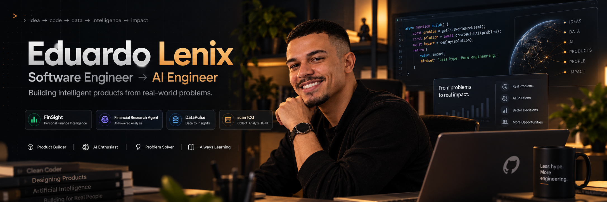
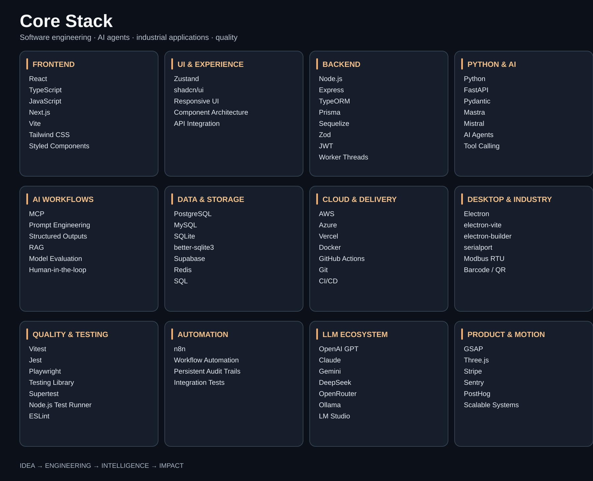

  
    
  
    
  
  

    
    &nbsp;
    
    &nbsp;
    
  

---

## The person behind the code

I'm Eduardo, a software engineer growing into **AI Engineering** by building and testing actual products. My work lives where **product thinking, strong software foundations, financial intelligence, and applied AI** meet.

I care about the entire path: understanding the problem, designing a useful experience, engineering dependable systems, and learning from what happens after a product ships.

> **My principle:** use deterministic code for facts and calculations; use AI where interpretation, research, and human decision support genuinely add value.

## Selected work

Real-world systems across industrial operations, AI-assisted service workflows, maintenance, and dependable backend engineering.

| Project | The problem it tackles | Core engineering |
| :--- | :--- | :--- |
| **[Nexo Assist (Nexos)](https://github.com/lenixeduardo/nexo-assist)** | AI-assisted service desk with human-approved ticket changes, PostgreSQL-backed sessions, audit trails, and service handoff. Live model integration requires independent end-to-end validation. | Node.js, TypeScript, Mastra, Mistral, PostgreSQL, Supabase, Zod, Vercel |
| **[labSerial](https://github.com/lenixeduardo/leitor-industrial)** | Desktop application for collecting industrial batch data from serial-connected equipment. Repository currently named `leitor-industrial`. | Electron, React, TypeScript, serialport, SQLite, electron-vite |
| **[PORTUS](https://github.com/lenixeduardo/portus)** | Traceable production and laboratory readings, shared batch lifecycle, barcode workflows, and industrial equipment integration. | Electron, React, TypeScript, Node.js, PostgreSQL, serialport, Modbus RTU, Vitest |
| **[KairOS](https://github.com/lenixeduardo/kairos)** | Maintenance management with QR-enabled work orders, role-based operations, and real-time visibility. | React, TypeScript, Node.js, Express, Prisma, PostgreSQL, JWT, Docker |
| **[DataPulse](https://github.com/lenixeduardo/datapulse)** | Process CPU-intensive reporting jobs without blocking the event loop and validate external API contracts at runtime. | Node.js, TypeScript, Express, Worker Threads, Zod, Docker, Vitest |
| **[scanTCG](https://github.com/lenixeduardo/Scantcg)** | Collectible-card marketplace and inventory experiences. | React, Vite, Tailwind CSS, Supabase, Stripe |

## Currently exploring

**FinSight** — a financial intelligence product concept focused on due dates, visibility, and practical decision support. Part of my ongoing work connecting finance, software design, and AI engineering.

My current learning loop:

`Understand the problem` → `Build a reliable system` → `Add intelligence deliberately` → `Evaluate` → `Improve`

## Skill Kit · Engineering toolkit

The visual **Core Stack** above highlights my everyday tools. This expanded inventory includes technologies from my professional experience and current AI engineering practice.

  
  
  
  
  
  
  
  
  
  
  
  
  
  
  
  

  
<strong>Software engineering · frontend · backend · desktop</strong>

   

  **Languages:** JavaScript · TypeScript · Python · SQL

  **Frontend:** React · Next.js · HTML5 · CSS3 · Tailwind CSS · Styled Components · shadcn/ui · Vite · Zustand · Context API · Responsive Design · Design Systems

  **Backend & integrations:** Node.js · Express · TypeORM · Prisma · FastAPI · Pydantic · Zod · Sequelize · REST APIs · API Integration · Systems Integration · Worker Threads · JWT

  **Desktop & mobile:** Electron · electron-vite · electron-builder · Windows Desktop Applications · Capacitor · Serial Port Integration · Modbus RTU · Barcode/QR Workflows

  **Engineering practices:** Software Architecture · Component Architecture · Reusable Components · Code Review · Scalability · Maintainability · Monorepos

  
<strong>AI engineering · agents · models</strong>

   

  **AI Engineering:** AI Agents · Agentic Workflows · Mastra · Generative AI · LLM Integration · Model Context Protocol (MCP) · Prompt Engineering · Structured Outputs · Schema Validation · AI Workflows · RAG · Tool Calling · Human-in-the-loop Approval · Model Evaluation · Persistent Audit Trails

  **Models & providers:** Mistral · Claude · OpenAI GPT · Google Gemini · DeepSeek · OpenRouter · Ollama · LM Studio

  
<strong>Databases · cloud · automation · quality</strong>

   

  **Data:** PostgreSQL · MySQL · Redis · SQLite · better-sqlite3 · Supabase · Prisma · SQL

  **Cloud & delivery:** AWS · Azure · Docker · Vercel · Git · GitHub · GitHub Actions · CI/CD · Stripe

  **Automation:** n8n · Workflow Automation · GitHub Actions

  **Testing & quality:** Vitest · Supertest · Node.js Test Runner · Testing Library · Playwright · ESLint · Jest · Code Review · Integration Tests

  **Observability:** Sentry · PostHog

  **Creative UI:** GSAP · Three.js

## What guides my work

- **Useful before impressive.** A product should solve a problem, not just demonstrate a stack.
- **Clarity scales.** Interfaces, code, and architecture should be understandable and maintainable.
- **Evidence over hype.** AI outputs need sources, evaluation, and clear boundaries.
- **Design belongs to engineering.** A reliable system and a thoughtful user experience reinforce each other.

  
<strong>GitHub activity</strong>

   
  

    
  

---

<strong>Build with intention. Learn in public. Make it useful.</strong>

Less hype. More engineering. · Eduardo Lenix

